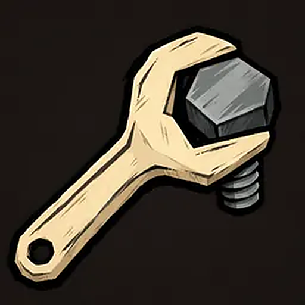

# Desbloquear QPS



**Versão 1.0.2 • Português brasileiro • Don't Starve Together • Windows 64 bits**

Atualização 1.0.2: remove o cache de metadados dos mods que podia manter versões vazias depois do download. A DLL nativa 1.0.1 continua ativa; o instalador corrige também o bloco conhecido do próprio mod QPS na Workshop, com backup.  mantém a descompactação ZIP/zlib original do DST mesmo com INI antigo. Corrige uma possível causa local de erros de mods ausentes; não contorna versões realmente incompatíveis.

Edição mantida por **café**. Desbloqueia a seleção de FPS do DST, oferece interpolação visual, ajustes de câmera e menus, opções de desempenho e carregamento. O limite de 144 FPS foi corrigido na DLL desta edição por meio do controle de apresentação EGL.

**Importante:** o mod da Steam Workshop **não instala automaticamente** a DLL necessária para ultrapassar o limite nativo do jogo. Os jogadores devem instalar o complemento nativo separadamente. Não é necessário instalar ou habilitar o HyperSmooth antigo.

## Página de download simplificada

**[ABRIR PÁGINA DE DOWNLOAD — Desbloquear QPS](https://efac000.github.io/Desbloquear-QPS/)**

A página mostra automaticamente a versão atual, um botão grande para **Baixar DLL + INI** e três passos simples de instalação. **Este é o link recomendado para a descrição da Steam Workshop.**

## Instale automaticamente em dois cliques

**Assinou o Desbloquear QPS pela Steam Workshop?** Instale somente a DLL.

1. [Baixe o ZIP pequeno (DLL + INI)](https://github.com/efac000/Desbloquear-QPS/releases/latest/download/Desbloquear-QPS-DLL-Windows-x64.zip) e extraia todos os arquivos.
2. Abra a pasta extraída Desbloquear QPS e dê dois cliques em **INSTALAR DLL.bat**. Confirme a autorização do Windows, se for solicitada.

Pronto! O instalador encontra a pasta do DST, coloca somente os arquivos nativos necessários, preserva o INI e faz backups. **Não instala uma segunda cópia do mod.** Se já existir outra DLL diferente, para por segurança. Feche o jogo antes de executar.

Sem comandos ou PowerShell. Consulte o [guia simples](docs/BAIXAR_DLL.md) para mais detalhes.

## DLL para quem veio da Workshop

**Já assinou o Desbloquear QPS na Steam? Não instale o mod outra vez. Baixe apenas a DLL.**

**[BAIXAR ZIP PEQUENO — DLL + INI](https://github.com/efac000/Desbloquear-QPS/releases/latest/download/Desbloquear-QPS-DLL-Windows-x64.zip)**

Prefere os arquivos separados? [Baixar dinput8.dll](https://github.com/efac000/Desbloquear-QPS/releases/latest/download/dinput8.dll) · [Baixar dst_fps.ini](https://github.com/efac000/Desbloquear-QPS/releases/latest/download/dst_fps.ini).

**Instalação manual em três passos:**

1. **Feche** o Don't Starve Together. Baixe o ZIP pequeno acima e extraia.
2. Abra a subpasta `bin64` do ZIP. Copie `dinput8.dll` e, se ainda não tiver, `dst_fps.ini` para a pasta `Steam\steamapps\common\Don't Starve Together\bin64` do jogo. Não copie a pasta inteira dentro de outra `bin64`.
3. Abra o jogo. Deixe **somente Desbloquear QPS** ativado nos **Mods de Cliente** e selecione o FPS desejado.

**Importante:** se já existir outra `dinput8.dll`, pare e faça um backup antes de substituí-la; ela pode pertencer a outro mod. Se já houver `dst_fps.ini`, preserve as configurações que você usa. O ZIP inclui instruções e um instalador opcional com backup: [guia simples da DLL](docs/BAIXAR_DLL.md).

**Link único para colocar na Workshop:** https://github.com/efac000/Desbloquear-QPS — os downloads ficam destacados no início desta página. A Workshop não instala DLLs na pasta do jogo automaticamente.

## Outros downloads

- **[Versão completa com DLL e instalador](https://github.com/efac000/Desbloquear-QPS/releases/latest)** — indicada para todos os jogadores do Windows 64 bits.
- [Pacote completo armazenado no repositório](pacotes/Desbloquear-QPS-v1.0.2-Completo.zip).
- [Pacote exclusivo para Steam Workshop](pacotes/Desbloquear-QPS-v1.0.2-Workshop.zip).
- [Ícone da Workshop, 512 × 512](icone-workshop-512.png).

O pacote completo contém os arquivos do mod, a DLL `dinput8.dll`, o arquivo `dst_fps.ini`, o instalador opcional e a documentação.

## Instalação rápida

### Opção 1 — Já assinou o mod na Steam Workshop?

**Instale apenas a DLL**, para não criar duas cópias do mesmo mod:

1. Baixe e extraia o pacote completo.
2. Feche o Don't Starve Together.
3. Abra o PowerShell dentro da pasta extraída `Desbloquear QPS`.
4. Confira a simulação:

   ```powershell
   powershell -NoProfile -ExecutionPolicy Bypass -File .\tools\instalar_local.ps1 -SomenteDLL
   ```

5. Para aplicar:

   ```powershell
   powershell -NoProfile -ExecutionPolicy Bypass -File .\tools\instalar_local.ps1 -SomenteDLL -Aplicar
   ```

6. Ative **Desbloquear QPS** na lista de *Mods de Cliente* e aplique.

### Opção 2 — Não usa a versão da Workshop?

Instale os arquivos do mod e o complemento nativo usando o pacote completo:

```powershell
powershell -NoProfile -ExecutionPolicy Bypass -File .\tools\instalar_local.ps1 -Aplicar
```

Se o jogo está em outra unidade, acrescente `-PastaJogo "D:\SteamLibrary\steamapps\common\Don't Starve Together"` com seu caminho real.

**Proteção:** o instalador começa em modo de simulação, cria cópias de segurança na Área de Trabalho ao aplicar, preserva o `dst_fps.ini` existente e **não substitui uma DLL diferente sem autorização**. Não apaga saves nem habilita mods sozinho. Execute como administrador apenas se o Windows exigir permissão de escrita na pasta da Steam.

[**Guia completo de instalação e solução de problemas**](docs/INSTALACAO.md)

## Recursos

- Alvos de FPS: **60, 120, 144, 165, 240, 360** e **Sem limite**.
- Correção opcional da sincronização da apresentação EGL que antes prendia o FPS ao monitor, incluindo 144 Hz.
- Interpolação visual e suavização da câmera, HUD com FPS e 1% Low, atalhos configuráveis.
- Otimizações de CPU/Lua/GC, menus, carregamento e reutilização de recursos.
- Perfil visual **Original** por padrão; efeitos adicionais são opcionais e começam desativados.
- Interface e mensagens próprias de uso em **português brasileiro**.

**Atenção:** selecionar 240 FPS não garante que sua GPU produza 240 quadros. Um monitor de 144 Hz exibe até 144 atualizações completas por segundo; FPS acima disso pode reduzir atrasos, mas também causar *screen tearing*. A função EGL não altera a velocidade da simulação do servidor.

## Organização do repositório

| Arquivo/pasta | Para que serve |
|---|---|
| `modinfo.lua`, `modmain.lua`, `keybind.lua` | Mod de cliente e suas configurações |
| `shaders/`, `modicon.tex`, `modicon.xml` | Recursos carregados pelo DST |
| `icone-workshop-512.png`, `preview.png` | Arte de 512 × 512 para a Workshop |
| `bin64/dinput8.dll`, `bin64/dst_fps.ini` | Complemento nativo para Windows x64 |
| `native_plugin/`, `tools/build_native.ps1` | Código-fonte C++ e compilação da DLL |
| `tools/instalar_local.ps1` | Instalação segura e reversível |
| `tools/gerar_pacotes.py` | Gera ZIP completo e ZIP da Workshop |
| `docs/`, `licenses/`, `LICENSE` | Manuais, QA, histórico e atribuições |

## Para quem vai publicar na Workshop

Use somente o [pacote da Workshop](pacotes/Desbloquear-QPS-v1.0.2-Workshop.zip) e a imagem `icone-workshop-512.png`. **Não publique o código C++, os pacotes ZIP, os arquivos de compilação nem a DLL dentro do item Workshop.** Inclua na descrição o link para instalar a DLL a partir deste repositório. Veja [o roteiro de publicação e texto pronto](docs/PUBLICACAO_WORKSHOP.md).

## Compatibilidade, autoria e licenças

- Mod de **cliente** para **Don't Starve Together no Windows 64 bits**. A DLL não foi homologada para Linux, macOS ou servidores dedicados.
- Não mantenha versões antigas do HyperSmooth/Café Smooth ativadas ao mesmo tempo.
- Nome, tradução, arte e modificações desta edição: **café**.
- Código-base derivado do **HyperSmooth 2.5.0**, com créditos do **Hakimi Tech Lab (wangxu1428)** preservados sob licença MIT. Bibliotecas estáticas: avisos em `licenses/`.
- Identificadores internos de API, nomes de teclas do DST e diagnósticos técnicos da DLL podem permanecer em inglês por compatibilidade. A interface **própria do mod** foi revisada em PT-BR; isso não traduz o próprio jogo.

**Estado de QA:** sintaxe Lua, estrutura, arquivos, DLL e pacotes verificados; os testes práticos de HUD e desbloqueio EGL foram realizados no PC de desenvolvimento. Isso não garante desempenho ou compatibilidade universal com todos os mods e servidores. Leia [validação](docs/QA.md) e [histórico](HISTORICO.md).
